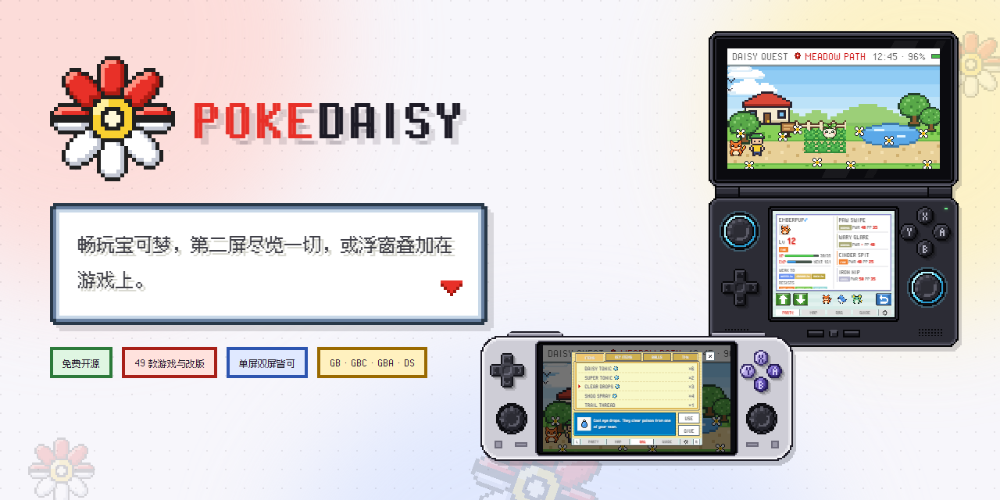

<h3>更好地游玩宝可梦。从 Game Boy 到 DS，实时伴侣、宽屏大地图、HUD 快捷菜单，繁琐操作一键完成。</h3>

  
  
  
  

  <strong><a href="https://github.com/lidor30/pokedaisy/releases/latest">下载</a></strong>
  · <strong><a href="#%E5%8A%9F%E8%83%BD">功能</a></strong>
  · <strong><a href="#%E6%94%AF%E6%8C%81%E7%9A%84%E6%B8%B8%E6%88%8F">支持的游戏</a></strong>
  · <strong><a href="https://pokedaisy.com/docs/">使用手册</a></strong>
  · <strong><a href="https://pokedaisy.com/feedback/#bug">问题反馈</a></strong>

  <strong>支持 PokeDaisy</strong> 
  
  
  

PokeDaisy 是一款面向双屏或单屏安卓掌机的 Game Boy、Game Boy Color、GBA 和任天堂 DS 播放器，
为从《红》到《黑》的每一代宝可梦游戏以及热门 ROM 改版而打造。游戏旁边运行着一个实时伴侣，
在你游玩时实时读取游戏数据：队伍、背包、地图、对战克制、图鉴和防剧透攻略，
全部以游戏自身的菜单风格绘制。

- **双屏设备**（AYN Thor、Retroid Pocket Duo 等）：上屏运行游戏，下屏显示伴侣面板。
- **单屏设备**（Retroid Pocket 6、手机等）：伴侣以悬浮窗或侧边面板的形式覆盖在游戏旁，
  HUD、快捷菜单和对战按钮把常用功能留在游戏画面上。
- **DS 游戏**（白金、心金、魂银、黑）：触摸屏放在下屏，点一下即可切换为伴侣面板。

## 设备

| 设备                     | 状态                                 |
| ------------------------ | ------------------------------------ |
| AYN Thor                 | 已实测，专为它打造                   |
| Retroid Pocket Duo Lite  | 已支持，有专属的 4:3 布局            |
| Retroid Pocket Duo       | 应该可用，尚未在真机上测试           |
| Anbernic RG DS           | 应该可用，尚未在真机上测试           |
| Retroid Pocket 6         | 单屏：已实测                         |
| 其他单屏掌机             | 应该可用，像 Pocket 6 一样横握       |
| 安卓手机（竖屏）         | 应该可用，仅截图检查过               |
| 手机投屏到电视           | 应该可用：游戏在电视上，伴侣在手机上 |

任何 Android 8.0+ 设备都可以运行游戏。

## 安装

1. 在设备上下载 [最新版本](https://github.com/lidor30/pokedaisy/releases/latest) 中的
   `PokeDaisy-<version>.apk` 并打开（如果 Android 询问，请允许浏览器或文件管理器安装应用）。
2. 打开 PokeDaisy。简短的初始设置会关联你的 ROM 文件夹、选择存档位置
   （PokeDaisy 自己的文件夹或其他模拟器的，比如 RetroArch），还可以添加封面图。
   这些以后都可以在设置中更改。

应用会自我更新：每次打开时都会提示新版本。完整手册见
[pokedaisy.com/docs](https://pokedaisy.com/docs/)，也可以在应用的 设置 > HELP 中查看。

**游戏不包含在内。** 请使用你自己合法转储的 ROM。

## 功能

**伴侣面板**

- **PARTY（队伍）**：以游戏自身的队伍界面显示你的队伍。点按任意宝可梦查看详情：
  能力值、招式、个体值 / 努力值、属性克制，以及值得学习的招式或 TM。
- **BAG（背包）**：每个口袋都有图标和描述，在允许的游戏中可以直接从背包使用或持有道具。
- **BATTLE（对战）**：自动打开。你的招式会标注 效果绝佳 / 效果不佳 / 一般 / 无效，
  对方的弱点、特性、道具和能力值，换谁上场、用哪个招式的建议，以及对方剩下的队伍。
- **MAP（地图）**：游戏自己的地区地图，实时显示你的位置，每个地点都可搜索，还能 FLY（飞行）。
- **DEX（图鉴）**：见过 / 收服、完整条目、进化链、每种宝可梦的捕捉地点和升级招式。
- **GUIDE（攻略）**：先看提示，再点一下看答案。当前区域有什么、下一个 Boss 的队伍、进化方式、
  小技巧，还有一个“卡住了？”（STUCK?）页面。
- **CARD**、**STATES**（10 个即时存档槽）、**ACHIEVEMENTS**（RetroAchievements 成就），
  以及底栏标签页可自定义。
- **NUZLOCKE**（按游戏区分，GBA 游戏但不含 Emerald Rogue）：为你的 Nuzlocke 挑战计分，
  记录每个区域的首次遭遇，每只濒死的宝可梦永久离场，队伍槽位上会立起墓碑。

**游戏画面内**

- **HUD**：行走时显示你的队伍、小地图、精灵球数量，以及 PC / BAG / WILD 按钮。
- **快捷菜单**（L3）：PC、FLY、BIKE、钓竿、驱虫喷雾、野外遭遇开关、即时存档。
- **对战按钮**：FIGHT、POKéMON 和 RUN 就放在对战画面旁边。
- **EXPAND（扩展画面）**：大地图绘制超出 GBA 屏幕边缘，填满宽屏，支持缩放和环顾。

**播放器**

- 快进（智能：菜单里正常速度，对战中加速）、音乐保持原速、慢动作、
  回放、真实时钟、即时存档、连发按钮。
- 着色器（LCD、扫描线、CRT、GBA 色彩、边缘平滑）、遮罩，以及你自己的 RetroArch 遮罩。
- 换装：用一个游戏的主角玩另一个游戏、宝可梦跟随、昼夜色调。
- 可重映射的按键和热键、可自定义布局的触屏按键、蓝牙和 USB 手柄。
- 可选作弊、关闭野外遭遇、TM 可重复使用、自动跑步和室内跑步。
- 游戏库带封面图、收藏、压缩包 ROM、双屏启动器，以及从 ES-DE、Cocoon、iiSU 等前端启动
  （[iiSU](docs/iisu/README.md)、[ES-DE](docs/es-de/README.md) 的配置说明）。
- 标准 `.sav` / `.srm` 存档，与 mGBA 和 RetroArch 通用。每次启动都会备份你的存档。
- 界面语言：英语、日语、法语、德语、意大利语、西班牙语、葡萄牙语和中文。

一切尽在[使用手册](https://pokedaisy.com/docs/)。

## 支持的游戏

任何 Game Boy、Game Boy Color、GBA 或 DS 游戏都可以运行。伴侣功能需要下列游戏之一，
且**必须是列出的确切版本**（ROM 改版按文件识别，其他版本会显示“不支持”提示）。

✅ 可用 · ◐ 部分支持 · — 暂不支持

| 游戏                           | 版本                       | 队伍 | 背包 | 战斗 | 地图 | 图鉴 | 攻略 |
| ------------------------------ | -------------------------- | :--: | :--: | :--: | :--: | :--: | :--: |
| Red / Blue (GB)                | 美版/欧版                  |  ✅  |  ✅  |  ◐   |  ✅  |  ✅  |  ✅  |
| PureRed / PureBlue (GB)        | 2.7.6                      |  ✅  |  ✅  |  ◐   |  ✅  |  ✅  |  —   |
| Yellow (GB)                    | 美版/欧版                  |  ✅  |  ✅  |  ◐   |  ✅  |  ✅  |  ✅  |
| Yellow (GB)                    | 德 / 法 / 意 / 西版        |  ✅  |  ✅  |  ◐   |  ✅  |  ✅  |  ✅  |
| Gold / Silver (GBC)            | 美版/欧版                  |  ✅  |  ✅  |  ◐   |  ✅  |  ✅  |  —   |
| Crystal (GBC)                  | 美版、美/欧版 rev 1、澳版  |  ✅  |  ✅  |  ◐   |  ✅  |  ✅  |  ✅  |
| Crystal Clear (GBC)            | 2.5.11、2.6.0（4 个构建）  |  ✅  |  ✅  |  ◐   |  ✅  |  ✅  |  —   |
| Prism (GBC)                    | 0.95 build 254             |  ✅  |  ✅  |  ◐   |  ✅  |  ✅  |  ✅  |
| Polished Crystal (GBC)         | 3.2.0-3.2.3（16 个构建）   |  ✅  |  ✅  |  ◐   |  ✅  |  ✅  |  ✅  |
| FireRed                        | 美版/欧版，rev 0 和 1      |  ✅  |  ✅  |  ✅   |  ✅  |  ✅  |  ✅  |
| FireRed                        | 西 / 德 / 法 / 意 / 日版   |  ✅  |  ✅  |  ✅   |  ✅  |  ✅  |  ✅  |
| LeafGreen                      | 美版/欧版，rev 0 和 1      |  ✅  |  ✅  |  ◐   |  ✅  |  ✅  |  ✅  |
| LeafGreen                      | 西 / 德 / 法 / 意 / 日版   |  ✅  |  ✅  |  ◐   |  ✅  |  ✅  |  ✅  |
| Emerald                        | 美版/欧版                  |  ✅  |  ✅  |  ✅   |  ✅  |  ✅  |  ✅  |
| Emerald                        | 西 / 德 / 法 / 意 / 日版   |  ✅  |  ✅  |  ✅   |  ✅  |  ✅  |  ✅  |
| Ruby                           | 美版，rev 0、1、2          |  ✅  |  ✅  |  ◐   |  ✅  |  ✅  |  ✅  |
| Ruby                           | 西/德/法/意/日版，rev 0-1  |  ✅  |  ✅  |  ◐   |  ✅  |  ✅  |  ✅  |
| Sapphire                       | 美版，rev 0、1、2          |  ✅  |  ✅  |  ◐   |  ✅  |  ✅  |  ✅  |
| Sapphire                       | 西/德/法/意/日版，rev 0-1  |  ✅  |  ✅  |  ◐   |  ✅  |  ✅  |  ✅  |
| Platinum (DS)                  | 美版 rev 1                 |  ✅  |  ✅  |  ◐   |  ✅  |  ✅  |  ✅  |
| HeartGold (DS)                 | 美版                       |  ✅  |  ✅  |  —   |  ✅  |  ✅  |  ✅  |
| SoulSilver (DS)                | 美版                       |  ✅  |  ✅  |  —   |  ✅  |  ✅  |  ✅  |
| Black (DS)                     | 美版/欧版                  |  ✅  |  ✅  |  ◐   |  ✅  |  ✅  |  ✅  |
| Unbound（无界）                | 2.1.1.1                    |  ✅  |  ✅  |  ◐   |  ✅  |  ✅  |  ✅  |
| Unbound                        | 2.1.1.1 法语版             |  ✅  |  ✅  |  ◐   |  ✅  |  ✅  |  ✅  |
| Radical Red（激进红）          | 4.1                        |  ✅  |  ✅  |  ◐   |  ✅  |  ✅  |  ✅  |
| Gaia                           | 3.2                        |  ✅  |  ✅  |  ◐   |  ✅  |  ✅  |  ✅  |
| Odyssey                        | 4.1.1                      |  ✅  |  ✅  |  ◐   |  ✅  |  ✅  |  ✅  |
| Heart and Soul                 | 2.0.6                      |  ✅  |  ✅  |  ✅   |  ✅  |  ✅  |  ✅  |
| Amethyst                       | 1.3.0、1.4.1               |  ✅  |  ✅  |  ◐   |  ✅  |  ✅  |  ✅  |
| Celia's Stupid Romhack         | 1.1.4                      |  ✅  |  ✅  |  ◐   |  ✅  |  ✅  |  ✅  |
| Orange Islands                 | Beta 5.7 及更早 beta       |  ✅  |  ✅  |  ◐   |  ✅  |  ✅  |  ✅  |
| Ultra Violet                   | 1.22                       |  ✅  |  ✅  |  ◐   |  ✅  |  ✅  |  ✅  |
| FireRed Rocket Edition         | 唯一发布版                 |  ✅  |  ✅  |  ◐   |  ✅  |  ✅  |  ✅  |
| Ash Gray                       | 4.5.3、Fork Bug Fix 1.0    |  ✅  |  ✅  |  ◐   |  ✅  |  ✅  |  ✅  |
| Ghost Grey                     | 1.0.1、1.0.2、1.0.4        |  ✅  |  ✅  |  ◐   |  ✅  |  ✅  |  ✅  |
| Sword and Shield Ultimate Plus | 1.2.1.2 及 3 个补丁        |  ✅  |  ✅  |  ◐   |  ✅  |  ✅  |  ✅  |
| GS Chronicles                  | 2.7.6                      |  ✅  |  ✅  |  ◐   |  ✅  |  ✅  |  ✅  |
| Recharged Yellow               | 1.8.0、1.9.0、1.9.4、1.9.7 |  ✅  |  ✅  |  ◐   |  ✅  |  ✅  |  ✅  |
| Emerald Legacy                 | 1.1.4                      |  ✅  |  ✅  |  ◐   |  ✅  |  ✅  |  ✅  |
| Lazarus                        | 2.0                        |  ✅  |  ✅  |  ✅   |  ✅  |  ✅  |  ◐   |
| Emerald Seaglass               | 3.0                        |  ✅  |  ✅  |  ◐   |  ✅  |  ✅  |  ◐   |
| Too Many Types 2               | 1.5.2                      |  ✅  |  ✅  |  ◐   |  ✅  |  ✅  |  ◐   |
| Glazed                         | 9.2.0                      |  ✅  |  ✅  |  ◐   |  ✅  |  ✅  |  ◐   |
| Emerald Imperium               | 1.3.1                      |  ✅  |  ✅  |  ◐   |  ✅  |  ✅  |  ◐   |
| Quetzal（格查尔）              | 英文 Alpha 9 v0            |  ✅  |  ✅  |  ◐   |  ✅  |  ✅  |  ◐   |
| Quetzal                        | 西语 Alpha 9 v0            |  ✅  |  ✅  |  ◐   |  ✅  |  ✅  |  ◐   |
| Quetzal                        | Alpha 9 v1（英 / 西）      |  ✅  |  ✅  |  ◐   |  ✅  |  ✅  |  ◐   |
| Quetzal                        | Alpha 0.8.4（英 / 西）     |  ✅  |  ✅  |  ◐   |  ✅  |  ✅  |  ◐   |
| Moemon Quetzal                 | Alpha 0.8.4 Hotfix（英/西）|  ✅  |  ✅  |  ◐   |  ✅  |  ✅  |  ◐   |
| Super Mariomon                 | 1.2.1-1.3、1.5.1、1.5.2    |  ✅  |  ✅  |  ◐   |  ✅  |  ✅  |  ◐   |
| Recharged Emerald              | 2.2.5、2.2.8、Rebalanced   |  ✅  |  ✅  |  ◐   |  ✅  |  ✅  |  ◐   |
| Elite Redux                    | 2.65.3b、2.65.4.1b         |  ✅  |  ✅  |  ◐   |  ✅  |  ✅  |  ◐   |
| Team Rocket Dragonsden         | 1.5                        |  ✅  |  ✅  |  ◐   |  ◐   |  —   |  ◐   |
| Wishes of Tomorrow             | 1.2.6                      |  ✅  |  ✅  |  ◐   |  ✅  |  ✅  |  ◐   |
| Dreamstone Mysteries           | 唯一发布版                 |  ✅  |  ✅  |  ◐   |  ✅  |  ✅  |  ◐   |
| Emerald Rogue                  | 2.2.1-EX                   |  ✅  |  ✅  |  ✅   |  ✅  |  ✅  |  —   |
| SoulGold                       | 1.1.4、1.2（3 个构建）     |  ✅  |  ✅  |  ◐   |  ✅  |  ✅  |  ◐   |
| R.O.W.E.                       | 2.1.9.1 Experimental       |  ✅  |  ✅  |  ◐   |  ✅  |  ◐   |  —   |

<strong>表格说明</strong>

对于未列出的版本，应用会尝试按它认识的游戏来读取（BEST EFFORT，尽力匹配），
不确定时会询问你选择哪个。地图 ◐ 表示只有地名，没有地图图片。攻略 ◐ 表示只有实时页面
（当前区域的野生遭遇和下一个 Boss）。战斗 ◐ 表示对战面板可用，但未在每种对战中检查过。
DS 上，心金和魂银的对战数据尚未读取。Team Rocket Dragonsden 是 DragonsdenTV 的
Team Rocket Edition，不是 FireRed Rocket Edition。Wishes of Tomorrow 开启随机化后，
攻略和图鉴的“地区”（AREA）页面会显示你的存档实际遇到的野生宝可梦。
各攻略由各游戏自身数据生成，可能含有错误。

想让其他游戏获得支持？到 [游戏请求](https://github.com/lidor30/pokedaisy/discussions/categories/game-requests)
发帖，并为你想要的游戏投票。

## 隐私

应用没有账号、广告和分析追踪，你的游戏和存档永远不会离开你的设备。它只在以下情况联网：
检查更新、获取封面图、使用 RetroAchievements（仅当你填写自己的密钥或登录时）、
发送崩溃报告（仅当你开启 CRASH REPORTS 时）、分享 BEST EFFORT 匹配结果
（仅当你点 SHARE 时：只发送 ROM 的哈希、大小和游戏代码，从不发送文件本身）。
网站仅以匿名方式统计访问量，不使用 Cookie。

## 社区与支持

欢迎来 [r/PokeDaisy](https://www.reddit.com/r/PokeDaisy/) 或
[Discord](https://discord.gg/vcmyKZZV5q) 打招呼、分享你的通关记录和提问。
发现 bug？[点这里反馈](https://pokedaisy.com/feedback/#bug)。

PokeDaisy 免费、无广告、无内购锁定。如果它让你的某次通关变得更美好，可以在
[Ko-fi](https://ko-fi.com/pokedaisy)、[Patreon](https://www.patreon.com/cw/pokedaisy) 或
[Buy Me a Coffee](https://buymeacoffee.com/lidor30g) 上支持它。赞助纯属自愿，不解锁任何功能，
所得仅用于 PokeDaisy 自身的开发：不出售、不分发任何游戏、ROM 或游戏内容。

## 从源码构建

见 [docs/DEVELOPMENT.md](docs/DEVELOPMENT.md)。

面向掌机的 Linux 构建（SDL2、同一 mGBA 核心和 3DS 移植版的伴侣）正处于早期测试阶段：
[linux/README.md](linux/README.md)。

<strong>AI 工具说明</strong>

本项目可能使用 AI 辅助开发工具（如 Claude Code）协助代码生成、重构和文档编写。
所有变更仍由维护者审查，并在发布前通过项目的既有检查。

## 鸣谢

mGBA、melonDS、rcheevos、字体、着色器、pret 反编译工程、封面图来源

- Game Boy、Game Boy Color 和 GBA 游戏由 Vicki Pfau (endrift) 及贡献者开发的 [mGBA](https://mgba.io) 运行
  （MPL 2.0；源代码在 [`third_party/mgba`](https://github.com/mgba-emu/mgba)），
  内含其捆绑的 blip_buf（LGPL 2.1）和 inih（BSD）。
- DS 游戏由 melonDS 团队开发的 [melonDS](https://melonds.kuribo64.net) 运行
  （GPL 3.0；源代码在 [`third_party/melonds`](https://github.com/melonDS-emu/melonDS)，
  PokeDaisy 的改动在 [`third_party/patches`](third_party/patches)），
  内含其捆绑的 FatFs、Teakra（MIT）、xxHash（BSD 2-Clause）、tiny-AES-c（Unlicense）、
  blip_buf（LGPL 2.1）和 Dolphin 的 ARM64 发射器（GPL 2.0+）。
- 成就系统使用 RetroAchievements.org 的 [rcheevos](https://github.com/RetroAchievements/rcheevos)（MIT）。
- [Pixel Operator](https://www.dafont.com/pixel-operator.font) 字体，作者 Jayvee Enaguas（CC0）；
  手册文字使用 [Atkinson Hyperlegible](https://www.brailleinstitute.org/freefont/)，
  由 Braille Institute 发布（OFL 1.1）。
- [PixelMplus](https://github.com/itouhiro/PixelMplus)（M+ FONT LICENSE，M+ FONTS PROJECT）
  用于日文文本，由 `scripts/gen_jp_font.py` 转换为 Pixel Operator 的像素网格。
- 中文文本使用 Fusion Pixel Font（缝合像素字体，OFL 1.1），由 `scripts/gen_zh_font.py` 子集化。
- [pret](https://github.com/pret) 反编译工程（pokered、pokeyellow、pokegold、pokecrystal、pokefirered、
  pokeemerald、pokeruby、pokeplatinum、pokeheartgold）、
  [pokeemerald-expansion](https://github.com/rh-hideout/pokeemerald-expansion)
  以及 [Polished Crystal](https://github.com/Rangi42/polishedcrystal) 和
  [PureRGB](https://github.com/Vortyne/pureRGB) 的源代码——游戏数据和攻略均与它们核对过。
- 画面着色器：LCD 和扫描线来自 mGBA（MIT），GBA 色彩由 Pokefan531 和 hunterk 制作，
  LCD PAPER 仿照 RetroArch 的 simpletex_lcd 和 zfast_lcd（GPL 2.0+），
  边缘平滑使用 libretro 的 xBR、xBRZ 和 ScaleFX（MIT，xBRZ 为 GPL 3.0）。
- [PokeAPI](https://pokeapi.co)（BSD 3-Clause）提供全国图鉴物种列表。
- AndroidX、Jetpack Compose、Kotlin 和 Apache Commons Compress（Apache 2.0）、XZ for Java（0BSD）。

所有许可证见 [NOTICE](NOTICE)，在应用内位于 设置 > LICENSES。
- 封面图来自 [SteamGridDB](https://www.steamgriddb.com) 及其贡献者，包装盒图来自 [RetroAchievements](https://retroachievements.org)。

## 许可证

PokeDaisy 是基于 [GNU GPL v3](LICENSE) 的自由软件，附带一个
[附加条款](NOTICE)：如果你分享 PokeDaisy 或任何基于它的作品，
请在文档和鸣谢中保留 **"Based on PokeDaisy by Lidor Itzhari -
https://github.com/lidor30/pokedaisy"** 署名。分支必须保持开源并使用相同许可证。

PokeDaisy 是同人项目，与任天堂、Game Freak、Creatures 或宝可梦公司无关，
也未获其背书。宝可梦及所有相关名称均为其各自所有者的商标；Game Boy、Game Boy Color
和 Game Boy Advance 是任天堂的商标。设备名称（AYN Thor、Retroid、Anbernic）属于
各自厂商，RetroAchievements 和 SteamGridDB 是独立服务；以上均未背书 PokeDaisy。
ROM 改版属于其创作者。不包含任何游戏、BIOS 或游戏素材：请使用你自己合法转储的 ROM。
